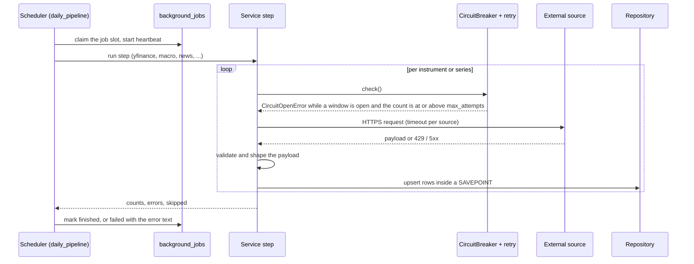
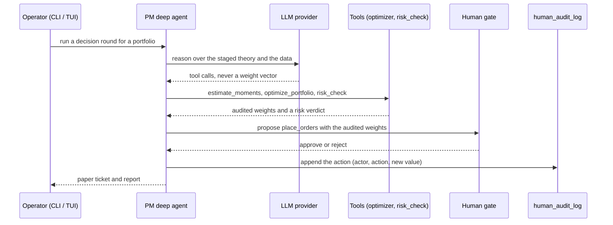

# External integrations

Every system the platform talks to, what it needs, what breaks without it and how the
code defends itself. Standard 2.10 asks for this per integration, with sequence and
communication diagrams. Values were read from the source on 2026-11-13, the external-call
settings below on 2026-11-15; the source file named under **Code** is the authority when
they differ.

## How the pieces talk

```mermaid
flowchart LR
    subgraph daemon["ingestion daemon (portopt)"]
        sched["APScheduler jobs"]
        svc["services"]
    end
    subgraph fundpkg["fund bridge (portopt-fund)"]
        graph["PM deep agent + tools"]
        tui["CLI / TUI"]
    end
    db[("PostgreSQL 16")]
    yahoo["Yahoo Finance (yfinance)"]
    fred["FRED API"]
    te["Trading Economics (HTML)"]
    sole["Il Sole 24 Ore (HTML)"]
    t212["Trading 212 API"]
    llm["LLM provider (10 supported)"]

    sched --> svc
    svc -- "HTTPS, no key" --> yahoo
    svc -- "HTTPS REST, api_key query param" --> fred
    svc -- "HTTPS scrape" --> te
    svc -- "HTTPS scrape" --> sole
    svc -- "HTTPS REST, Basic auth" --> t212
    svc -- "SQL (psycopg2)" --> db
    tui --> graph
    graph -- "HTTPS via LangChain" --> llm
    graph -- "SQL (psycopg), langgraph schema" --> db
    graph -- "reads prices" --> db
```

## Daily ingestion round



## One fund round



## External-call settings and metrics

The ingestion daemon reads these settings from its environment (`ingestion/app/config.py`).
They are not in `ingestion/.env.example` yet; once the owner adds them there, their entries
must leave `_DOCUMENTED_OUTSIDE_THE_TEMPLATE` in
`ingestion/tests/unit/setup/test_env_templates.py`.

| Variable | Default | Sets |
|---|---|---|
| `BREAKER_YFINANCE_MAX_ATTEMPTS` | 10 | `max_attempts` of the Yahoo breaker |
| `BREAKER_FRED_MAX_ATTEMPTS` | 8 | `max_attempts` of the FRED breaker |
| `BREAKER_TRADINGECONOMICS_MAX_ATTEMPTS` | 5 | `max_attempts` of the Trading Economics breaker |
| `BREAKER_ILSOLE_MAX_ATTEMPTS` | 5 | `max_attempts` of the Il Sole breaker |
| `BREAKER_TRADING_212_MAX_ATTEMPTS` | 5 | `max_attempts` of the Trading 212 breaker, which is new |
| `FRED_REQUEST_ATTEMPTS` | 5 | attempts per FRED request, the first included |
| `TRADINGECONOMICS_REQUEST_ATTEMPTS` | 3 | attempts per Trading Economics page, the first included |
| `ILSOLE_REQUEST_ATTEMPTS` | 3 | attempts per Il Sole page, the first included |
| `TRADING_212_REQUEST_ATTEMPTS` | 5 | attempts per Trading 212 request, the first included |
| `FRED_REQUEST_TIMEOUT_SECONDS` | 30.0 | `requests` timeout of a FRED request |
| `TRADINGECONOMICS_REQUEST_TIMEOUT_SECONDS` | 20.0 | `requests` timeout of a Trading Economics request |
| `ILSOLE_REQUEST_TIMEOUT_SECONDS` | 10.0 | `requests` timeout of an Il Sole request |
| `TRADING_212_REQUEST_TIMEOUT_SECONDS` | 30.0 | `requests` timeout of a Trading 212 request |
| `FRED_RETRY_BASE_DELAY_SECONDS` | 1.0 | base of FRED's retry backoff for errors `is_transient_network_error` does not flag |
| `FRED_RETRY_MAX_DELAY_SECONDS` | 60.0 | cap of that backoff |

An attempt count that is not an integer of at least 1, or a duration that is not a finite
number above 0, fails at startup with an error that names the variable (`ge=1`, `gt=0` and
`allow_inf_nan=False` in `config.py`). The defaults are the values the code used before,
except `BREAKER_TRADING_212_MAX_ATTEMPTS`: the Trading 212 client had no breaker (see
Trading 212 for its new retry path). A scraper built with an explicit `timeout` keeps it.

How the breakers count (paths from the repository root):

- The count is net. `trigger()` adds one unless a window is still open
  (`ingestion/app/services/infrastructure/circuit_breaker.py:64-70`). `reset()` takes one
  off (`ingestion/app/services/infrastructure/circuit_breaker.py:120-124`), and the FRED,
  Trading Economics, Il Sole and Trading 212 clients call it after a successful request
  (`ingestion/app/services/macro/scrapers/fred_scraper.py:185`,
  `ingestion/app/services/macro/scrapers/tradingeconomics_scraper.py:867`,
  `ingestion/app/services/macro/scrapers/ilsole_scraper.py:157`,
  `ingestion/app/services/universe/trading212/client.py:213`). The half-open branch of
  `check()`, which lets a request through after a window has ended, also takes one off
  (`ingestion/app/services/infrastructure/circuit_breaker.py:107-114`).
- `check()` raises `CircuitOpenError` while a window is open and the count is at
  `max_attempts` or more
  (`ingestion/app/services/infrastructure/circuit_breaker.py:98-104`).
- When FRED answers a 4xx other than 408 or 429, the FRED client ends the request at once,
  without a retry, and returns an error result
  (`ingestion/app/services/macro/scrapers/fred_scraper.py:186-194, 244-248`). Of the other
  request errors, the FRED, Trading Economics and Il Sole clients pass to `trigger()`
  those that `is_transient_network_error` flags
  (`ingestion/app/services/infrastructure/retry.py:185-187`;
  `ingestion/app/services/macro/scrapers/fred_scraper.py:183-184`,
  `ingestion/app/services/macro/scrapers/tradingeconomics_scraper.py:865-866`,
  `ingestion/app/services/macro/scrapers/ilsole_scraper.py:155-156`). Trading Economics
  also calls `trigger()` for a page that no longer parses
  (`ingestion/app/services/macro/scrapers/tradingeconomics_scraper.py:478, 660, 835`). Any
  other request error of those three clients is not passed to `trigger()`; when attempts
  remain, the retry helper sleeps a jittered backoff before the next attempt
  (`ingestion/app/services/infrastructure/retry.py:194-196`).
- Window sizes, jitter and backoff: see
  `ingestion/app/services/infrastructure/circuit_breaker.py`,
  `ingestion/app/services/infrastructure/retry.py` and the client modules.

Metrics, served by the worker when metrics are enabled:

- `external_breaker_open{service}`: the worker binds it to the four process-wide breakers
  (`ingestion/app/worker.py:102-103`); it reads 1 while the breaker's `is_open` is true,
  that is while `check()` would refuse
  (`ingestion/app/services/infrastructure/circuit_breaker.py:138-146`), and 0 otherwise.
- `external_request_seconds{service,outcome}`: the duration of the HTTP requests these
  four clients send inside `timed_request`
  (`ingestion/app/services/infrastructure/external_calls.py:90-112`;
  `ingestion/app/services/macro/scrapers/fred_scraper.py:242`,
  `ingestion/app/services/macro/scrapers/tradingeconomics_scraper.py:857`,
  `ingestion/app/services/macro/scrapers/ilsole_scraper.py:147`,
  `ingestion/app/services/universe/trading212/client.py:236`); `outcome` is `error` when
  the timed block raised, `ok` otherwise.
- `service` is one of `FRED API`, `Trading Economics`, `IlSole24Ore` and `Trading 212`.

## Yahoo Finance

- **API**: the `yfinance` library over HTTPS (prices, profiles, statements, holders, news,
  options, ETF data). Rate limiting is shared by one limiter and one breaker.
- **Authentication**: none.
- **Impact if down**: no new prices or fundamentals. The universe, the macro data and the
  fund keep working on stored data. The fund marks NAV only after the day's price sweep
  has settled, so a failed sweep delays the mark instead of using a partial one.
- **Risk and mitigation**: Yahoo throttles and changes routes. `CircuitBreaker` backs off
  exponentially (default 2 min base, 30 min cap; `max_attempts` from
  `BREAKER_YFINANCE_MAX_ATTEMPTS`, default 10) and a case-sensitive substring
  check marks transient errors. `YFINANCE_FETCH_WORKERS` (1 to 16, default 4) bounds
  concurrency and `YFINANCE_REQUEST_TIMEOUT_SECONDS` bounds each request. A 404 means one
  empty module, not a dead symbol. The retired ticker-news feed falls back to Yahoo search.
  Price repair needs scikit-learn.
- **Code**: `ingestion/app/services/market_data/yfinance_data_service.py`,
  `ingestion/app/services/market_data/yfinance/_facade.py`,
  `ingestion/app/services/infrastructure/circuit_breaker.py`,
  `ingestion/app/services/infrastructure/rate_limiter.py`,
  `ingestion/app/services/infrastructure/retry.py`.

## FRED

- **API**: `https://api.stlouisfed.org/fred`, JSON observations per series, used monthly.
- **Authentication**: the key travels as the `api_key` query parameter, set through
  `FRED_API_KEY` or the `fred_api_key` Docker secret.
- **Impact if down**: the monthly macro series stop updating; stored series stay readable.
- **Risk and mitigation**: because the key is in the URL, `requests` echoes it in errors.
  `redact_secrets` masks it in log messages and the retry helper redacts the exception text
  and attaches no traceback. Timeout, attempts, backoff and breaker size: see
  "External-call settings and metrics".
- **Code**: `ingestion/app/services/macro/scrapers/fred_scraper.py`,
  `ingestion/app/utils/log_redaction.py`, `ingestion/app/services/infrastructure/retry.py`.

## Trading 212

- **API**: REST under `https://live.trading212.com` or `https://demo.trading212.com`
  (`TRADING_212_MODE`), used for the instrument catalogue that flags which names are
  tradeable on the broker.
- **Authentication**: HTTP Basic with `TRADING_212_API_KEY` and `TRADING_212_SECRET_KEY`.
  Without both, the annotation step skips and nothing else depends on it.
- **Impact if down**: `is_t212_tradeable` stays as last evaluated. A portfolio with
  `tradeable_only` set keeps its last known universe.
- **Risk and mitigation**: the catalogue endpoint allows about one call per 50 s and
  reports the window end in `x-ratelimit-reset`. The requests `Trading212Client` sends go
  through `retry_with_backoff` and a circuit breaker
  (`ingestion/app/services/universe/trading212/client.py:205-214, 227-233`). A 408, a 429
  or a 5xx answer, and a `requests` failure that is not an HTTP error, such as a timeout
  or a body that is not JSON, are passed to the breaker's `trigger()` and retried while
  attempts remain, unless the breaker refuses the attempt; any other 4xx, and an HTTP
  error without a response, is raised at once (`_trips_breaker`,
  `ingestion/app/services/universe/trading212/client.py:46-59`). The wait a 429 reports
  can lengthen the breaker's window, which stays capped at 120 s
  (`ingestion/app/services/universe/trading212/client.py:256-286`;
  `ingestion/app/services/infrastructure/external_calls.py:70`). The clients that
  `Trading212Client.from_settings` builds share the process-wide breaker
  (`ingestion/app/services/universe/trading212/client.py:349`). When it refuses with
  `CircuitOpenError`, `run_t212_annotate` raises before it reads or writes any instrument
  (`ingestion/app/services/universe/t212_annotate.py:357-358`) and `add-instrument` treats
  the catalogue as unavailable
  (`ingestion/app/services/universe/add_instrument.py:104-106`). Timeout, attempts and
  breaker size: see "External-call settings and metrics". The credentials are not part of
  any `repr`.
- **Code**: `ingestion/app/services/universe/trading212/client.py`,
  `ingestion/app/services/universe/t212_annotate.py`.

## Trading Economics

- **API**: HTML tables scraped from `https://tradingeconomics.com` (indicators, bond
  yields), no public API used.
- **Authentication**: none.
- **Impact if down**: the macro snapshot tables stop refreshing.
- **Risk and mitigation**: a markup change breaks the parser silently, and once a response
  that could not be decoded froze the table for 16 days; the scraper therefore never
  advertises `br` in `Accept-Encoding`. Rows that mix non-comparable measures are skipped.
  Timeout, attempts and breaker size: see "External-call settings and metrics".
- **Code**: `ingestion/app/services/macro/scrapers/tradingeconomics_scraper.py`.

## Il Sole 24 Ore

- **API**: one HTML page,
  `https://mercati.ilsole24ore.com/dati-macroeconomici/paesi-a-confronto`, parsed for
  country macro data.
- **Authentication**: none.
- **Impact if down**: that country comparison stops refreshing.
- **Risk and mitigation**: the same markup risk as Trading Economics. `Accept-Encoding` is
  pinned to `gzip, deflate`. Timeout, attempts and breaker size: see "External-call
  settings and metrics".
- **Code**: `ingestion/app/services/macro/scrapers/ilsole_scraper.py`.

## Business Insider

- **API**: not called by this repository. `yfinance`'s experimental `Ticker.isin` searches
  Business Insider by company name and returns an ISIN.
- **Authentication**: none.
- **Impact if down**: ISINs are not filled in for new instruments, which only weakens the
  Trading 212 matching.
- **Risk and mitigation**: a name search can return another security's ISIN. Only a
  suffix-less symbol is trusted, a venue-suffixed one is never given an ISIN from this
  source, and `t212_annotate` stores the ISIN it looked up.
- **Code**: `ingestion/app/services/market_data/yfinance/ticker/_isin.py`,
  `ingestion/app/services/universe/t212_annotate.py`.

## LLM providers

- **API**: ten LangChain chat-model backends selected by `LLM_PROVIDER`: `ollama` (default,
  DeepSeek on Ollama Cloud), `openai`, `openrouter`, `anthropic`, `groq`, `google`, `aws`,
  `microsoft`, `nvidia` and `huggingface`. See ADR-0006.
- **Authentication**: one key per provider (`OLLAMA_API_KEY`, `OPENAI_API_KEY`,
  `ANTHROPIC_API_KEY`, `GOOGLE_API_KEY`, `GROQ_API_KEY`, `NVIDIA_API_KEY`,
  `OPENROUTER_API_KEY`, `HUGGINGFACEHUB_API_TOKEN`, `AZURE_OPENAI_API_KEY`), read from the
  environment or a Docker secret at `/run/secrets`. `aws` uses the standard AWS credentials.
  Keys are validated when a model is built, never at import, and are kept out of `repr`.
- **Impact if down**: no new fund rounds and no Ask answers. Stored portfolios, prices and
  the audit trail are unaffected.
- **LangSmith gateway**: `langchain-core` reads `LANGSMITH_GATEWAY` (`true`, or a gateway
  URL) from the process environment, and a provider class that applies it sends a model
  whose endpoint the builder did not pass to the gateway host instead of the provider's
  own, with its prompts and the provider key. Checked on 2026-11-26 at the locked
  versions: `openai` without `OPENAI_BASE_URL`, `anthropic`, `google` and `aws` (the
  Bedrock endpoint) are redirected; `openrouter`, `microsoft`, `openai` with a base URL,
  `groq`, `ollama`, `nvidia` and `huggingface` are not, though a later release of a
  provider package can change that. No gateway key is needed for the redirect.
  `build_chat_model` therefore refuses to build any provider's model while the variable
  is set to anything but `false`, `0`, `no` or empty (`RuntimeError`, before the
  provider builder runs; the value is not echoed). Unset it for the process that runs
  `fund`; a line in the root `.env` that the compose `fund` service reads has the same
  effect. The `langsmith_gateway()` context manager is code, not environment, and
  `fund` does not use it.
- **Risk and mitigation**: every tool result an agent reads is sent to the chosen provider.
  The model never supplies weights: `place_orders` accepts only audited optimizer output
  after a passing risk verdict and a human approval. Deadlines are set per provider
  builder (`model.py` explains why a missing one can block the daemon), the primary model
  has one fallback, and structured output is validated with pydantic and retried.
  Providers hang intermittently (one Ollama Cloud call blocked for 180 s), so a round can
  stall until its deadline.
- **Code**: `fund/src/fund/agents/model.py`, `fund/src/fund/config.py`,
  `fund/src/fund/agents/graph.py`, `fund/src/fund/tools/orders.py`,
  `fund/src/fund/actions.py`.

## Article sites (news enrichment)

News links found through Yahoo are fetched from arbitrary public sites by `ArticleScraper`
(`ingestion/app/services/market_data/yfinance/news/scraper.py`, timeout 10 s). The fetch
allows only http and https, re-checks every redirect, refuses any host that resolves to a
non-public address, caps the download size and strips control characters, because the URLs
come from third parties.
