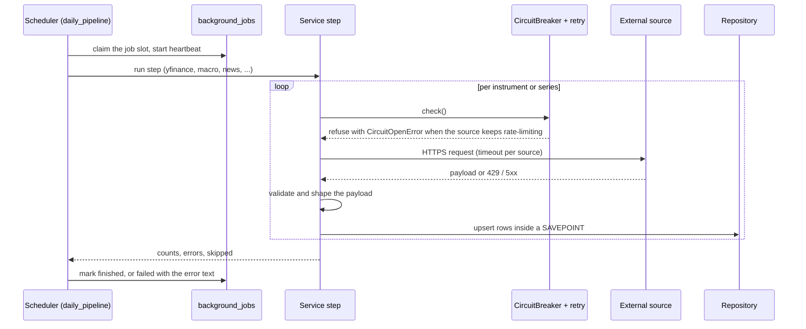
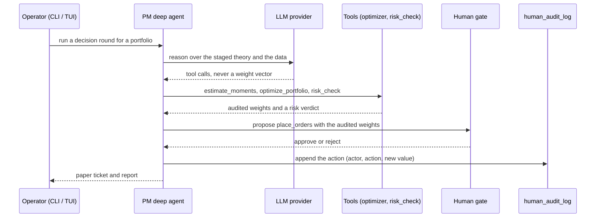

# External integrations

Every system the platform talks to, what it needs, what breaks without it and how the
code defends itself. Standard 2.10 asks for this per integration, with sequence and
communication diagrams. Values were read from the source on 2026-11-13; the source file
named under **Code** is the authority when they differ.

## How the pieces talk

```mermaid
flowchart LR
    subgraph daemon["ingestion daemon (portopt)"]
        sched["APScheduler jobs"]
        svc["services"]
    end
    subgraph fundpkg["fund bridge (portopt-fund)"]
        graph["PM deep agent + tools"]
        tui["CLI / TUI"]
    end
    db[("PostgreSQL 16")]
    yahoo["Yahoo Finance (yfinance)"]
    fred["FRED API"]
    te["Trading Economics (HTML)"]
    sole["Il Sole 24 Ore (HTML)"]
    t212["Trading 212 API"]
    llm["LLM provider (10 supported)"]

    sched --> svc
    svc -- "HTTPS, no key" --> yahoo
    svc -- "HTTPS REST, api_key query param" --> fred
    svc -- "HTTPS scrape" --> te
    svc -- "HTTPS scrape" --> sole
    svc -- "HTTPS REST, Basic auth" --> t212
    svc -- "SQL (psycopg2)" --> db
    tui --> graph
    graph -- "HTTPS via LangChain" --> llm
    graph -- "SQL (psycopg), langgraph schema" --> db
    graph -- "reads prices" --> db
```

## Daily ingestion round



## One fund round



## Yahoo Finance

- **API**: the `yfinance` library over HTTPS (prices, profiles, statements, holders, news,
  options, ETF data). Rate limiting is shared by one limiter and one breaker.
- **Authentication**: none.
- **Impact if down**: no new prices or fundamentals. The universe, the macro data and the
  fund keep working on stored data. The fund marks NAV only after the day's price sweep
  has settled, so a failed sweep delays the mark instead of using a partial one.
- **Risk and mitigation**: Yahoo throttles and changes routes. `CircuitBreaker` backs off
  exponentially (default 2 min base, 30 min cap, 10 attempts) and a case-sensitive substring
  check marks transient errors. `YFINANCE_FETCH_WORKERS` (1 to 16, default 4) bounds
  concurrency and `YFINANCE_REQUEST_TIMEOUT_SECONDS` bounds each request. A 404 means one
  empty module, not a dead symbol. The retired ticker-news feed falls back to Yahoo search.
  Price repair needs scikit-learn.
- **Code**: `ingestion/app/services/market_data/yfinance_data_service.py`,
  `ingestion/app/services/market_data/yfinance/_facade.py`,
  `ingestion/app/services/infrastructure/circuit_breaker.py`,
  `ingestion/app/services/infrastructure/rate_limiter.py`,
  `ingestion/app/services/infrastructure/retry.py`.

## FRED

- **API**: `https://api.stlouisfed.org/fred`, JSON observations per series, used monthly.
- **Authentication**: the key travels as the `api_key` query parameter, set through
  `FRED_API_KEY` or the `fred_api_key` Docker secret.
- **Impact if down**: the monthly macro series stop updating; stored series stay readable.
- **Risk and mitigation**: because the key is in the URL, `requests` echoes it in errors.
  `redact_secrets` masks it in log messages and the retry helper redacts the exception text
  and attaches no traceback. Timeout 30 s, five retries with backoff from 1 s to 60 s, and a
  module-level breaker that opens after eight failures.
- **Code**: `ingestion/app/services/macro/scrapers/fred_scraper.py`,
  `ingestion/app/utils/log_redaction.py`, `ingestion/app/services/infrastructure/retry.py`.

## Trading 212

- **API**: REST under `https://live.trading212.com` or `https://demo.trading212.com`
  (`TRADING_212_MODE`), used for the instrument catalogue that flags which names are
  tradeable on the broker.
- **Authentication**: HTTP Basic with `TRADING_212_API_KEY` and `TRADING_212_SECRET_KEY`.
  Without both, the annotation step skips and nothing else depends on it.
- **Impact if down**: `is_t212_tradeable` stays as last evaluated. A portfolio with
  `tradeable_only` set keeps its last known universe.
- **Risk and mitigation**: the catalogue endpoint allows about one call per 50 s and reports
  the window end in `x-ratelimit-reset`. The wait after a 429 is capped at 120 s, and a
  server-sent `Retry-After` is clamped to the same ceiling. Timeout 30 s. The credentials
  are not part of any `repr`.
- **Code**: `ingestion/app/services/universe/trading212/client.py`,
  `ingestion/app/services/universe/t212_annotate.py`.

## Trading Economics

- **API**: HTML tables scraped from `https://tradingeconomics.com` (indicators, bond
  yields), no public API used.
- **Authentication**: none.
- **Impact if down**: the macro snapshot tables stop refreshing.
- **Risk and mitigation**: a markup change breaks the parser silently, and once a response
  that could not be decoded froze the table for 16 days; the scraper therefore never
  advertises `br` in `Accept-Encoding`. Rows that mix non-comparable measures are skipped.
  Timeout 20 s, three retries, module-level breaker opening after five failures.
- **Code**: `ingestion/app/services/macro/scrapers/tradingeconomics_scraper.py`.

## Il Sole 24 Ore

- **API**: one HTML page,
  `https://mercati.ilsole24ore.com/dati-macroeconomici/paesi-a-confronto`, parsed for
  country macro data.
- **Authentication**: none.
- **Impact if down**: that country comparison stops refreshing.
- **Risk and mitigation**: the same markup risk as Trading Economics. `Accept-Encoding` is
  pinned to `gzip, deflate`. Timeout 10 s, three retries, breaker after five failures.
- **Code**: `ingestion/app/services/macro/scrapers/ilsole_scraper.py`.

## Business Insider

- **API**: not called by this repository. `yfinance`'s experimental `Ticker.isin` searches
  Business Insider by company name and returns an ISIN.
- **Authentication**: none.
- **Impact if down**: ISINs are not filled in for new instruments, which only weakens the
  Trading 212 matching.
- **Risk and mitigation**: a name search can return another security's ISIN. Only a
  suffix-less symbol is trusted, a venue-suffixed one is never given an ISIN from this
  source, and `t212_annotate` stores the ISIN it looked up.
- **Code**: `ingestion/app/services/market_data/yfinance/ticker/_isin.py`,
  `ingestion/app/services/universe/t212_annotate.py`.

## LLM providers

- **API**: ten LangChain chat-model backends selected by `LLM_PROVIDER`: `ollama` (default,
  DeepSeek on Ollama Cloud), `openai`, `openrouter`, `anthropic`, `groq`, `google`, `aws`,
  `microsoft`, `nvidia` and `huggingface`. See ADR-0006.
- **Authentication**: one key per provider (`OLLAMA_API_KEY`, `OPENAI_API_KEY`,
  `ANTHROPIC_API_KEY`, `GOOGLE_API_KEY`, `GROQ_API_KEY`, `NVIDIA_API_KEY`,
  `OPENROUTER_API_KEY`, `HUGGINGFACEHUB_API_TOKEN`, `AZURE_OPENAI_API_KEY`), read from the
  environment or a Docker secret at `/run/secrets`. `aws` uses the standard AWS credentials.
  Keys are validated when a model is built, never at import, and are kept out of `repr`.
- **Impact if down**: no new fund rounds and no Ask answers. Stored portfolios, prices and
  the audit trail are unaffected.
- **Risk and mitigation**: every tool result an agent reads is sent to the chosen provider.
  The model never supplies weights: `place_orders` accepts only audited optimizer output
  after a passing risk verdict and a human approval. Deadlines are set per provider
  builder (`model.py` explains why a missing one can block the daemon), the primary model
  has one fallback, and structured output is validated with pydantic and retried.
  Providers hang intermittently (one Ollama Cloud call blocked for 180 s), so a round can
  stall until its deadline.
- **Code**: `fund/src/fund/agents/model.py`, `fund/src/fund/config.py`,
  `fund/src/fund/agents/graph.py`, `fund/src/fund/tools/orders.py`,
  `fund/src/fund/actions.py`.

## Article sites (news enrichment)

News links found through Yahoo are fetched from arbitrary public sites by `ArticleScraper`
(`ingestion/app/services/market_data/yfinance/news/scraper.py`, timeout 10 s). The fetch
allows only http and https, re-checks every redirect, refuses any host that resolves to a
non-public address, caps the download size and strips control characters, because the URLs
come from third parties.
